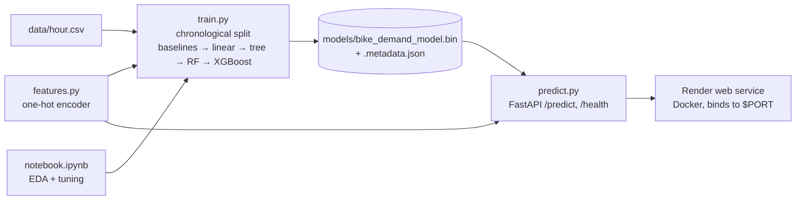

# Bike Sharing Demand Prediction (ML Zoomcamp Midterm Project)

An automated machine-learning service that estimates hourly bike-sharing rental demand
from calendar information for the next day.

**Live service:** deployed on Render — `https://<service-name>.onrender.com` (replace with the URL Render
assigns after the first deploy; see [Deployment](#-deployment-render)).

---

## 📋 Problem description

Bike-sharing operators must plan next-day fleet capacity and staffing at the system
level. Demand varies by hour, weekday and season, so a calendar-only forecast can be
produced a day in advance without any weather data:

* **Who uses it:** fleet operators and city planners estimating overall demand for
  rebalancing runs and staffing.
* **How it would be used:** the intended interface receives the calendar features for
  the next 24 hours and returns an expected **total** rental count per hour for the whole
  system. It is an aggregate demand signal, not a per-station allocation: there is no
  station identifier in the data or the request, so the model cannot say how many bikes
  belong at an individual station.
* **Target variable:** `cnt` (total rentals per hour, casual + registered).
* **Task:** supervised regression.
* **Scope:** a historical course-project demonstration on the 2011–2012 UCI data. `yr`
  only distinguishes those two years, so the reported errors come from chronological
  holdout periods inside 2011–2012; performance for current or future years is not
  established.
* **Primary metric:** **RMSLE** — RMSE computed on `log1p(cnt)`. Rationale: demand spans
  roughly 0–1,000 rentals per hour, so an unweighted RMSE in counts is dominated by a few
  busy hours, while RMSLE weights relative errors evenly and is the metric used by the
  original UCI/Kaggle formulation of this problem.
* **Secondary metrics:** log-scale MAE, and MAE/RMSE in rentals per hour.

---

## 🗂️ Dataset

[UCI Bike Sharing Dataset](https://archive.ics.uci.edu/dataset/275/bike+sharing+dataset),
file `hour.csv`, committed in this repository at `data/hour.csv` (1.1 MB, SHA-256
`e03de4ee…a2f829504f`, recorded in the model metadata).

* **Rows:** 17,379 hourly records, 2011-01-01 → 2012-12-31.
* **Completeness:** 76 of 731 days are missing one or more hours (nothing is imputed;
  the hours were simply never recorded).
* **Features used:** `season`, `yr`, `mnth`, `hr`, `holiday`, `weekday`, `workingday`.
* **Features deliberately excluded:**
  * `temp`, `atemp`, `hum`, `windspeed`, `weathersit` — these are *observed* weather. A
    genuine day-ahead forecast does not know tomorrow's weather, so using them would
    make the offline score optimistic and the service unusable.
  * `casual` and `registered` — they sum exactly to `cnt`, i.e. target leakage
    (verified in the notebook: 0 rows where `casual + registered != cnt`).

---

## 🔎 EDA summary

Full analysis with plots is in [`notebook.ipynb`](notebook.ipynb) (sections 2–5); the
notebook is the reference for the charts, this is the summary:

* **Target:** right-skewed, most hours below 300 rentals, tail to ~1,000; `log1p`
  compresses the tail and makes RMSLE the natural loss.
* **Hour of day:** strongest signal — two commute peaks on working days, a broad
  afternoon peak at weekends.
* **Calendar structure:** demand is higher in warm months and grows from 2011 to 2012,
  which is what `season`, `mnth` and `yr` encode.
* **Data quality:** no missing cells in used columns, no duplicate rows, no impossible
  ranges; only the missing hours noted above.
* **Mean demand per split** shows the drift that dominates the test result:
  train 167.7, validation 288.4 (peak season), test 219.2 (autumn).

---

## 🧪 Modeling

Chronological split, because the product forecasts the future:

| Split | Period | Rows |
|---|---|---|
| train | 2011-01-01 → 2012-06-30 | 13,003 |
| validation | 2012-07-01 → 2012-09-30 | 2,208 |
| test | 2012-10-01 → 2012-12-31 | 2,168 |

Every choice (features, hyperparameters, boosting rounds) is made on **validation only**.
The test period is scored once, at the end.

Features are one-hot encoded calendar values (53 columns). Stochastic models are run with
5 seeds (`0–4`) and reported as mean ± std.

### Validation results (RMSLE, mean ± std over seeds)

| Model | RMSLE ↓ | log MAE ↓ |
|---|---|---|
| tuned XGBoost (`eta=0.1`, `max_depth=4`, 329 rounds) | **0.3201 ± 0.0061** | **0.2544 ± 0.0065** |
| random forest (100 trees, depth 16) | 0.3941 ± 0.0013 | 0.3128 ± 0.0008 |
| linear regression (one-hot) | 0.5898 | 0.4476 |
| decision tree (depth 8) | 0.7002 ± 0.0002 | 0.5806 ± 0.0001 |
| baseline: weekday × hour mean | 0.7332 | 0.6885 |
| baseline: global mean | 1.4867 | 1.3428 |

The XGBoost gain over the random forest (0.074) is far larger than the seed spread
(≤0.006), so that difference is supported. The six tuning configurations, by contrast,
sit within 0.007 of each other with spreads of up to 0.010 — the exact winner is noise and
the search should not be read as "these are the right hyperparameters".

### Test result (single evaluation, model refitted on train + validation)

| Metric | Value |
|---|---|
| RMSLE | **0.524** |
| log-scale MAE | 0.337 |
| MAE | 56.7 rentals/hour |
| RMSE | 95.1 rentals/hour |

Validation was 0.320, so the test error is about 60 % higher. This is drift, not a bug:
July–September is peak season (mean 288 rentals/hour) and the test period averages 219,
and the model has no weather input that could explain the autumn drop. One chronological
holdout is also one sample, not a generalisation estimate.

All metrics are computed identically for every model: predictions are converted back to
counts (`expm1`), clipped at 0, and RMSLE is `RMSE(log1p(actual), log1p(clipped prediction))`.

---

## 🏗️ Architecture



`features.py` is shared by training and serving, so the one-hot matrix cannot drift
between the two paths.

---

## 📁 Repository structure

```text
├── data/hour.csv                  # raw dataset (committed)
├── models/
│   ├── bike_demand_model.bin      # features + trained booster (+ metadata)
│   └── bike_demand_model.metadata.json
├── notebook.ipynb                 # EDA, model selection, tuning
├── features.py                    # one-hot encoder shared by train/serve
├── metrics.py                     # RMSLE / log-MAE / count metrics
├── train.py                       # trains, evaluates on test once, saves artifact
├── predict.py                     # FastAPI service (/predict, /health, /)
├── tests/                         # pytest: metrics, features, API
├── render.yaml                    # Render Blueprint (Docker web service)
├── Dockerfile                     # container image, binds to $PORT
├── Pipfile / Pipfile.lock         # dependencies (pytest is a dev dependency)
├── requirements.txt               # pinned runtime dependencies (used by Docker)
└── README.md
```

---

## 🚀 How to run

### 1. Install dependencies

```bash
pipenv install --dev        # dev adds pytest
```

### 2. Train the model

```bash
pipenv run python train.py
```

Takes ~20 s on a laptop CPU. It prints versions, dataset hash and git SHA, the
validation comparison, the single test evaluation, and writes:

* `models/bike_demand_model.bin` — feature list + booster (+ run metadata),
* `models/bike_demand_model.metadata.json` — seeds, hyperparameters, splits, metrics,
  dataset hash, git SHA, library versions.

### 3. Run the tests

```bash
pipenv run python -m pytest -q
```

16 tests: metric definitions, encoder behaviour (column order, unseen categories), and
API behaviour (health, prediction shape, range validation, commute-peak sanity check).

### 4. Run the service locally

```bash
pipenv run uvicorn predict:app --host 0.0.0.0 --port 8000
```

### 5. Run with Docker

```bash
docker build -t bike-sharing-prediction .
docker run -p 8000:8000 bike-sharing-prediction
```

The image binds to `$PORT` and defaults to `8000`, so the same image works locally and on
Render: `docker run -e PORT=9000 -p 9000:9000 bike-sharing-prediction`.

---

## 🔌 API

| Endpoint | Method | Purpose |
|---|---|---|
| `/health` | GET | Liveness check, returns `{"status": "ok"}` |
| `/predict` | POST | Rental counts for one or more hours |
| `/` | GET | Service info: feature count, training time, git SHA, test metrics |
| `/docs` | GET | Interactive OpenAPI documentation |

Request fields and valid ranges (out-of-range input returns HTTP 422):
`season` 1–4, `yr` 0–1, `mnth` 1–12, `hr` 0–23, `holiday` 0–1, `weekday` 0–6,
`workingday` 0–1.

```bash
curl -X POST "http://localhost:8000/predict" \
  -H "Content-Type: application/json" \
  -d '{
    "hours": [
      {"season": 4, "yr": 1, "mnth": 10, "hr": 0, "holiday": 0, "weekday": 1, "workingday": 1},
      {"season": 4, "yr": 1, "mnth": 10, "hr": 8, "holiday": 0, "weekday": 1, "workingday": 1}
    ]
  }'
```

Response (verified against the running container):

```json
{"predictions": [44, 725]}
```

---

## ☁️ Deployment (Render)

[`render.yaml`](render.yaml) is a Render Blueprint describing a Docker web service:
free plan, Frankfurt region, health check on `/health`. The container reads `$PORT` from
the environment, which is how Render routes traffic — no port configuration needed in the
dashboard.

### Option A — Blueprint (recommended)

1. Push this repository to GitHub (Render deploys from a Git repo, not from a local folder).
2. Render Dashboard → **New +** → **Blueprint** → select the repository → **Apply**.
3. Render creates the service, builds the root `Dockerfile`, and deploys it. The first
   build installs the pinned dependencies and takes a few minutes.
4. Verify the assigned URL (also shown in the dashboard):

```bash
curl -s "https://<service-name>.onrender.com/health"
# {"status": "ok"}

curl -s -X POST "https://<service-name>.onrender.com/predict" \
  -H "Content-Type: application/json" \
  -d '{"hours":[{"season":4,"yr":1,"mnth":10,"hr":8,"holiday":0,"weekday":1,"workingday":1}]}'
# {"predictions":[725]}
```

Replace the placeholder URL at the top of this README with the real one.

### Option B — Manual web service

If you prefer the dashboard over the Blueprint: **New +** → **Web Service** → connect the
repo → Language **Docker** → health check path `/health` → instance type **Free** → Deploy.
The service then builds the same `Dockerfile` with the repository root as build context.

### Notes and caveats

* **Free instance cold starts:** the free plan spins down after ~15 minutes without traffic,
  so the first request after a quiet period waits roughly 30–60 s. Render returns a slow
  response rather than an error; a paid instance removes this.
* **Model artifact:** the trained model is committed at `models/bike_demand_model.bin`, so
  the image is self-contained and does not retrain at build time.
* **`$PORT` binding:** the Dockerfile ends with
  `exec uvicorn predict:app --host 0.0.0.0 --port ${PORT}`; changing the hard-coded port
  would break Render routing.
* **Auto-deploy:** by default Render redeploys on every push to the connected branch.
* **Not verified against the live platform:** the image was built and exercised locally
  (`/health` = 200, `/predict` returns the values above) and `render.yaml` was parsed as
  valid YAML, but the first real Render deploy needs your account and repository.

---

## 🔁 Reproducibility

* **Seeds:** `42` initialises NumPy and the final model; `[0, 1, 2, 3, 4]` is used for
  every repeated model so mean ± std can be reported. All seeds are written to
  `models/bike_demand_model.metadata.json`.
* **Run metadata:** dataset SHA-256, split dates and row counts, resolved
  hyperparameters, validation and test metrics, library versions, Python version and git
  SHA are saved next to the model and printed by `train.py`.
* **Dependencies:** pinned in `Pipfile.lock` and `requirements.txt`
  (pandas 3.0.6, NumPy 2.5.4, scikit-learn 1.9.1, XGBoost 3.4.1, FastAPI 0.143.0).
* **Notebook:** run top to bottom; it reuses the same split dates and encoder logic.
* **Commit to submit:** note the commit hash of the repository in the submission form;
  the same hash is embedded in the model metadata.

---

## ⚠️ Limitations and next steps

* **Calendar features only.** The largest realistic improvement is next-day weather
  *forecasts* from a weather API, not the observed weather in this dataset.
* **One chronological holdout.** The validation → test gap (0.320 → 0.524) measures
  seasonality drift plus luck. Rolling-origin validation over several months would give a
  spread instead of one number.
* **Early stopping and tuning both use validation**, so validation is slightly
  optimistic; the untouched test period limits but does not remove this.
* **`yr` is a single step**, so two years of growth are captured as one jump, not a trend.
* **Hour/month are one-hot**, not cyclical; harmless here because all values appear in
  training, but sin/cos encodings are the usual fix for extrapolation.
* **No monitoring in the deployed service** — predictions are stateless and not logged.
